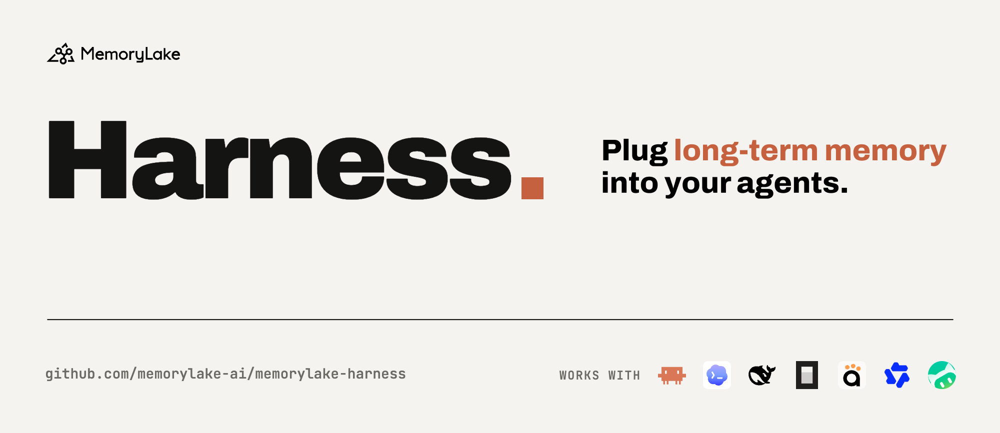
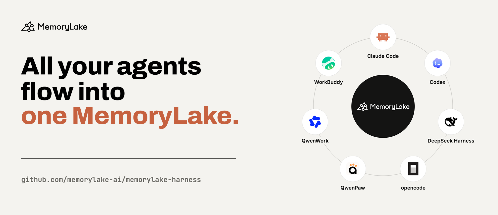

<p align="center">
  <a href="https://memorylake.ai">
    
  </a>
</p>

Client-side harnesses that connect coding agents to
[MemoryLake](https://memorylake.ai) — cross-device long-term memory.
(Two deployments, separate accounts: [memorylake.ai](https://memorylake.ai)
international, [memorylake.cn](https://memorylake.cn) China; the CLI defaults
to the international endpoint.)

| Harness | Client | Status |
| --- | --- | --- |
| [`claude-plugin/`](claude-plugin/) | Claude Code | working — recall on read, sync on write, session status |
| [`codex-plugin/`](codex-plugin/) | Codex | working — recall skill, per-turn memory sync, session status |
| [`dsh-plugin/`](dsh-plugin/) | DeepSeek Harness (dsh) | working — memory tools, prompt guidance, session status; published as `@memorylake/dsh-plugin` |
| [`opencode-plugin/`](opencode-plugin/) | opencode | working — memory tools, prompt guidance, compaction guidance; published as `@memorylake/opencode-plugin` |
| [`qwenpaw-plugin/`](qwenpaw-plugin/) | QwenPaw | working — memory backend plugin: automatic recall, memory tools, Console form, `/memorylake-status`; installs from a zip |
| [`qwenwork-plugin/`](qwenwork-plugin/) | QwenWork | working — search-first reminder every turn, per-turn conversation sync, session status; the QwenWork agent installs it from this repo |
| [`workbuddy-plugin/`](workbuddy-plugin/) | WorkBuddy | working — one install with everything: search-first recall every turn (reminder + gate), per-turn conversation sync, attached files, the CLI inside the plugin, a sign-in page it opens itself |
| [`workbuddy-connector/`](workbuddy-connector/) | WorkBuddy | built, awaiting listing — CLI + Skill connector for WorkBuddy's connector market: sign-in page, CLI install and upgrade, skills for recall, memory and access; recall is up to the agent |

<p align="center">
  
</p>

All harnesses share one identity and data tree (`~/.memorylake/harness/`):
configure once, use from every client.

Every harness drives the [`memorylake` CLI](https://github.com/memorylake-ai/memorylake-cli)
under the hood and fetches it on demand during setup, so none of the installs
below needs a separate download. Put the CLI on your `PATH` to reach the same
memory from a terminal or a script — see [From the terminal](#from-the-terminal).

## Claude Code

```
/plugin marketplace add memorylake-ai/memorylake-harness
/plugin install memorylake@memorylake
/memorylake:init
```

See [`claude-plugin/README.md`](claude-plugin/README.md) for configuration,
privacy notes, and design rationale.

## Codex

```
codex plugin marketplace add memorylake-ai/memorylake-harness
codex plugin add memorylake@memorylake
set up memorylake
```

The last line is asked inside a Codex session, after trusting the hooks via
`/hooks`. See [`codex-plugin/README.md`](codex-plugin/README.md).

## DeepSeek Harness (dsh)

```
dsh plugin --profile web add @memorylake/dsh-plugin
dsh web
/memorylake-init
```

The last line is typed in a session; machines already set up for Claude Code
or Codex can skip it. See [`dsh-plugin/README.md`](dsh-plugin/README.md).

## opencode

```
opencode plugin @memorylake/opencode-plugin -g
set up memorylake
```

The last line is typed in a session; machines already set up for another
harness can skip it. See [`opencode-plugin/README.md`](opencode-plugin/README.md).

## QwenPaw

```
qwenpaw plugin install https://github.com/memorylake-ai/memorylake-harness/releases/download/qwenpaw-plugin-v0.2.2/memory-memorylake-0.2.2.zip
```

Then, per Agent, in the Console: Agent settings → Memory backend → Memory
Lake. On a machine already set up for another harness the form can stay
empty. See [`qwenpaw-plugin/README.md`](qwenpaw-plugin/README.md).

## QwenWork

In a QwenWork conversation, send:

```
Install the MemoryLake plugin by following qwenwork-plugin/INSTALL.md in https://github.com/memorylake-ai/memorylake-harness
```

The agent installs the plugin and runs the setup; machines already set up
for another harness skip the setup. **Agents installing into QwenWork: follow
[`qwenwork-plugin/INSTALL.md`](qwenwork-plugin/INSTALL.md)** -- the plugin is
that directory, not the repository root. See
[`qwenwork-plugin/README.md`](qwenwork-plugin/README.md).

## WorkBuddy

In WorkBuddy: Skills → Plugins → **+** (add marketplace), add the built
plugin, and install **memorylake**. That is all: the plugin carries the
`memorylake` CLI, and the first session opens a page in the browser to sign
in, pick a workspace and choose what is remembered. Machines already set up
for another harness skip the page. See
[`workbuddy-plugin/README.md`](workbuddy-plugin/README.md).

WorkBuddy also gets a **connector** for its connector market:
[`workbuddy-connector/`](workbuddy-connector/), awaiting listing. Connecting
it installs the CLI, opens the same page to sign in to MemoryLake, and adds
the same skills; automatic recall and sync are a switch on that page. Either
is complete alone. With both installed the plugin's hooks act and the
connector's stand down. Both use the same
CLI login on a machine. See
[`workbuddy-connector/README.md`](workbuddy-connector/README.md).

## From the terminal

The harnesses log in through the CLI and keep the credentials where the CLI
keeps them (`~/.memorylake/credentials.toml`), so a CLI you install yourself on
a machine already set up for any harness is logged in from the first command:

```bash
curl -fsSL https://raw.githubusercontent.com/memorylake-ai/memorylake-cli/main/scripts/install.sh | sh
memorylake auth status
memorylake lib upload ./report.pdf
memorylake search "what did we decide about the schema"
```

Windows: `irm https://raw.githubusercontent.com/memorylake-ai/memorylake-cli/main/scripts/install.ps1 | iex`.
The full command reference — files, facts, databases, conversations, agents,
skills, teams — is in the
[memorylake-cli README](https://github.com/memorylake-ai/memorylake-cli#commands).

## Beyond coding sessions

The memory the harnesses write to is the same one a team's calls, meetings,
documents and agents can land in.
[memorylake-usecases](https://github.com/memorylake-ai/memorylake-usecases)
has runnable demos of that — sales calls, meetings, a codebase, contract review,
bookkeeping, agent bug replay, Reflexion-style agent memory and more — each a
directory with sample data, a CLI runner that prints every command, a local web
UI and a recorded run. A machine set up for any harness can run them as is: the
demos use the CLI the harness installed and, with `MEMORYLAKE_API_KEY` unset, its
login.
